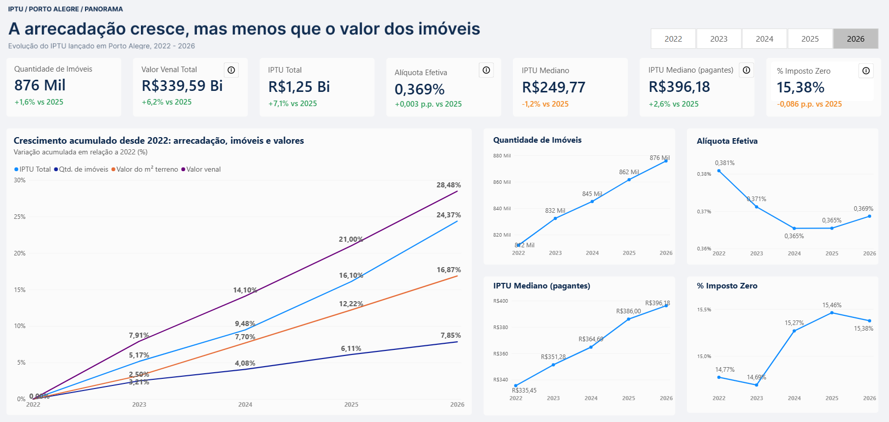
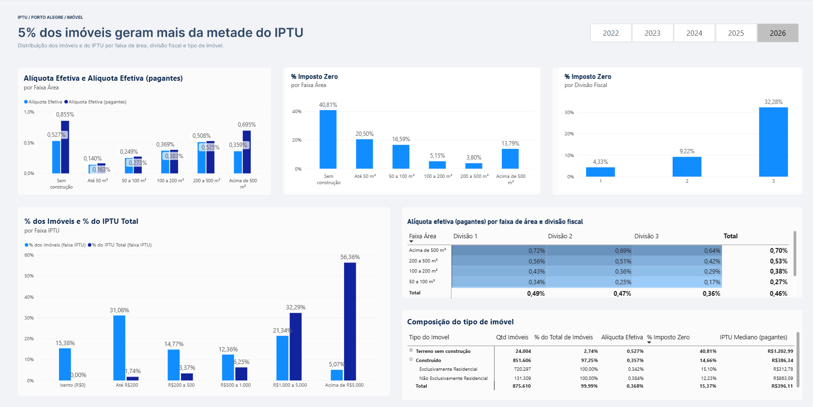
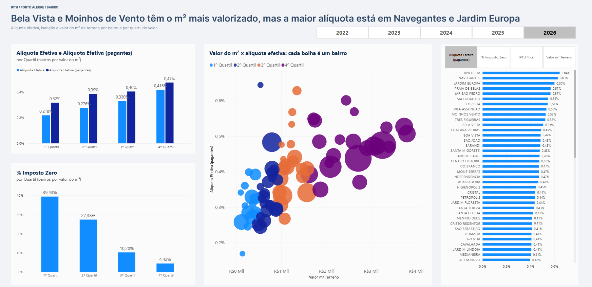

# Como a carga do IPTU se distribui em Porto Alegre?

Análise em Power BI sobre a distribuição do IPTU lançado em Porto Alegre (2022-2026).

**🔗 [Abrir o relatório no Power BI](https://app.powerbi.com/view?r=eyJrIjoiYmE2MTJhN2UtMTgzNC00NjczLTg4ZTgtYjcxZTUzZDBjNDMxIiwidCI6IjU0NDllMjE1LWNjYTAtNGZjMS1hMzBlLWM1MWNmNzkyZWMzNCJ9)** · [Medidas DAX](Medidas%20BI/) · [Scripts SQL](sql/)
## Pergunta de negócio
Como o IPTU lançado em Porto Alegre se distribui entre os imóveis, e a carga acompanha o tamanho, o valor e a localização deles?
## Resposta resumida
O IPTU lançado é **progressivo e concentrado em poucos imóveis**, mas a **localização e o tipo do imóvel alteram a carga de forma relevante**. Há grupos com isenção alta (terrenos, Divisão 3, imóveis acima de 500 m²) que merecem investigação.
## Principais achados

### 1. O IPTU lançado cresce, mas menos que o valor dos imóveis
Entre 2022 e 2026, o crescimento acumulado foi:

| Indicador | Variação acumulada vs 2022 |
|---|---|
| Valor venal total | +28,48% |
| IPTU total | +24,37% |
| Valor do m² de terreno | +16,87% |
| Quantidade de imóveis | +7,85% |

- Em 2026, o IPTU total é de **R$ 1,25 bi** (+7,1% vs 2025) sobre um valor venal de **R$ 339,59 bi** (+6,2% vs 2025), com **876 mil imóveis** (+1,6%).
- Como o valor venal cresceu mais que a arrecadação, a **alíquota efetiva caiu de 0,381% (2022) para 0,365% (2024-2025)**, subindo levemente para **0,369% em 2026** (+0,003 p.p.). Ou seja, a alíquota efetiva de 2026 ainda está abaixo da de 2022.
- Parte do crescimento da arrecadação vem de mais imóveis (+7,85%), e não só de reavaliação.

### 2. A isenção é relevante e muito desigual
- **15,38% dos imóveis não pagam IPTU** em 2026 (14,77% em 2022, pico de 15,46% em 2025). O salto aconteceu em 2024 (de 14,69% para 15,27%).
- O IPTU mediano geral é de **R$ 249,77** (-1,2%), enquanto o mediano entre quem paga é de **R$ 396,18** (+2,6%). A diferença mostra o peso dos isentos na mediana.
- **Por faixa de área:** a isenção é maior nos imóveis até 50 m² (**20,50%**) e de 50 a 100 m² (**16,59%**), cai para 5,15% (100-200 m²) e 3,80% (200-500 m²), e sobe de novo para **13,79%** acima de 500 m².
- **Por divisão fiscal:** 4,33% na Divisão 1, 9,22% na Divisão 2 e **32,28% na Divisão 3**, uma diferença de quase 8 vezes.
- **Por tipo de imóvel:** terrenos sem construção têm **40,81%** de isenção, contra 14,66% dos imóveis construídos (15,10% nos residenciais exclusivos e 12,23% nos não exclusivamente residenciais).

### 3. O IPTU lançado é muito concentrado
- Os imóveis com IPTU acima de R$ 5.000 são só **5,07%** do total, mas respondem por **56,36% da arrecadação**.
- Somando a faixa de R$ 1.000 a 5.000 (21,34% dos imóveis, 32,29% do IPTU), **mais de 26% dos imóveis geram cerca de 89% do IPTU**.
- No outro extremo, os imóveis isentos (15,38%) e os que pagam até R$ 200 (31,08%) somam quase **46% dos imóveis, mas apenas 1,74% do IPTU**.

### 4. A alíquota tende a subir com o tamanho e o valor, com exceções
- **Por área:** a alíquota efetiva cresce de 0,140% (até 50 m²) para 0,249%, 0,369% e 0,508% (200-500 m²). Acima de 500 m², a alíquota efetiva total cai para 0,359%, mas a **alíquota entre pagantes chega a 0,695%**, a maior de todas. A diferença entre as duas se explica pela alta isenção nessa faixa (13,79%).
- **Por divisão fiscal (pagantes):** a Divisão 1 tem as maiores alíquotas (0,47% no total) e a Divisão 3 as menores (0,34%). Isso vale em todas as faixas de área: na faixa de 200 a 500 m², por exemplo, são 0,56% (Div. 1), 0,51% (Div. 2) e 0,42% (Div. 3).
- **Por quartil de valor do m² (bairros):** a alíquota efetiva sobe de 0,218% (1º quartil) para 0,416% (4º), e entre pagantes de 0,32% para 0,47%. Já a isenção cai de **39,43%** (1º quartil) para **4,42%** (4º).
- **Exceções por bairro:** as maiores alíquotas entre pagantes estão em **Anchieta (0,64%), Navegantes (0,63%) e Jardim Europa (0,60%)**, nem todos entre os bairros de m² mais caro. 

### 5. Interpretação
- O sistema é **progressivo no conjunto**: quem tem imóvel maior, mais valioso ou em bairro mais caro paga alíquota maior e concentra a arrecadação.
- A **isenção é bem focalizada** em imóveis pequenos e bairros de menor valor, mas também atinge 13,79% dos imóveis acima de 500 m² e 40,81% dos terrenos sem construção.
- Os **terrenos sem construção** concentram os extremos: a maior taxa de isenção (40,81%) e o maior IPTU mediano entre pagantes (R$ 1.202,99). 
- A **desigualdade entre divisões fiscais** mostra que a localização pesa na alíquota, não só o valor do imóvel.

**Hipóteses a validar** *(não comprovadas pelos dados)*
- A isenção acima de 500 m² pode estar ligada a imóveis de entidades imunes ou de uso institucional.
- O aumento da isenção em 2024 coincide com as enchentes de maio, mas a coincidência de datas não prova a causa.
- A mediana alta dos terrenos pode vir de alíquota territorial diferenciada.
  
## Páginas do relatório

### 1. Capa

### 2. Panorama
Evolução do IPTU, imóveis, valor venal e alíquota efetiva (2022-2026).

### 3. Imóvel
Perfil por faixa de área, divisão fiscal, faixa de IPTU e tipo de imóvel.

### 4. Bairro
Alíquota, isenção e valor do m² por bairro e por quartil de valor.

## Ferramentas
Power BI, DAX, SQL, Figma (design)

## Dados
Fonte: Dados Abertos POA (https://dadosabertos.poa.br/dataset/iptu). Data de referência: base baixada em 21/10/2026, com IPTU lançado de 2022 a 2026.
